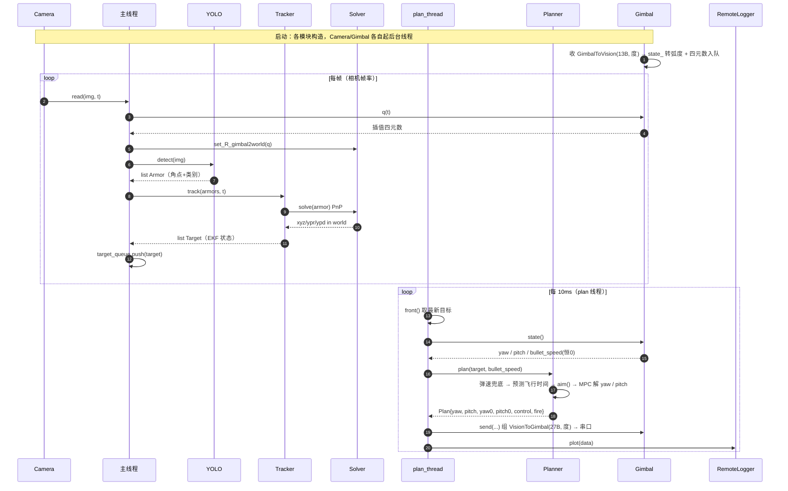

# 系统架构总览

## 项目定位

本项目是一套用于 RoboMaster 竞赛的**自瞄系统**，运行在机器人车载 NUC 上，通过视觉识别敌方装甲板并控制云台自动瞄准射击。

与传统 ROS 方案不同，本项目采用**模块化视觉框架**：
- 单一可执行文件按云台模式信号路由到不同任务模块（自瞄/打符/全景感知）
- 不依赖 ROS 消息总线，延迟更低、部署更简单
- ROS2 仅用于哨兵导航通信，核心自瞄功能不需要

---

## 四层架构

```
┌─────────────────────────────────────────────────────┐
│  src/  应用层                                        │
│  standard_mpc.cpp / sentry.cpp / uav.cpp            │
│  每种机器人一个可执行文件，负责模块编排和模式路由      │
├─────────────────────────────────────────────────────┤
│  tasks/  任务层                                      │
│  auto_aim/  打符/  全景感知/                         │
│  具体功能实现：检测、跟踪、规划、控制                  │
├─────────────────────────────────────────────────────┤
│  tools/  工具层                                      │
│  EKF / 弹道计算 / YAML配置 / 线程安全队列 / 录制      │
├─────────────────────────────────────────────────────┤
│  io/  硬件抽象层                                     │
│  camera / gimbal / serial / imu                     │
│  统一接口，屏蔽相机型号和通信协议差异                  │
└─────────────────────────────────────────────────────┘
```

---

## 数据流

```
相机线程
  图像 + 时间戳
       ↓
  云台线程（四元数）
       ↓
  Detector（装甲板4角点）
       ↓
  Estimator / Tracker（EKF 目标运动状态）
       ↓
  Planner（TinyMPC 轨迹优化）
       ↓
  Controller（云台指令）
       ↓
  Gimbal（串口/CAN 发送）
```

**关键延迟节点**：
- 图像采集 → 检测完成：~10ms（OpenVINO GPU 推理）
- 检测完成 → 云台执行：~5ms（EKF + MPC）
- 总系统延迟：~15ms，由 `low_speed_delay_time` / `high_speed_delay_time` 补偿

---

## 多线程模型

### 标准模式（standard_mpc）

```
主线程：
  while(true) {
    img = camera.get()          // 阻塞等待新帧
    q   = gimbal.q(img.time)    // 插值获取对应时刻四元数
    detections = detector(img)  // YOLO 推理
    target = tracker.update(detections, q)  // EKF 更新
    plan = planner.plan(target, bullet_speed)
    gimbal.send(plan)
  }

云台读线程（独立）：
  while(true) {
    读串口 → 解析 GimbalToVision → 推入四元数队列
  }
```

### 多线程模式（mt_auto_aim_debug）

检测在独立线程池中运行，通过 `thread_safe_queue` 与主线程通信，进一步降低延迟。

---

## 支持的机器人类型

| 可执行文件 | 机器人 | 特点 |
|---|---|---|
| `standard_mpc` | 步兵 | MPC 轨迹规划，主力版本 |
| `auto_aim_debug_mpc` | 步兵（调试） | 带 PlotJuggler 可视化 |
| `mt_auto_aim_debug` | 步兵（多线程） | 检测线程分离 |
| `sentry` | 哨兵 | 需要 ROS2，含导航通信 |

---

## 硬件支持

### 相机

| 类型 | 驱动位置 | 说明 |
|---|---|---|
| 迈德威视（MindVision） | `io/mindvision/` | 工业相机，SDK 驱动 |
| 海康威视（HikRobot） | `io/hikrobot/` | 工业相机，SDK 驱动 |
| USB 相机 | `io/usbcamera/` | OpenCV VideoCapture |

通过 YAML 配置切换，代码层面统一接口。

### 云台通信

| 协议 | 驱动位置 | 说明 |
|---|---|---|
| 虚拟串口 | `io/serial/` + `io/gimbal/` | 新协议，当前主用 |
| USB2CAN | SocketCAN | 旧协议 |

---

## 构建与运行

```bash
# 配置并编译
cmake -B build
make -C build/ -j$(nproc)

# 运行主程序
./build/standard_mpc

# 调试工具
./build/planner_test_offline   # 离线测试规划器（不需要硬件）
./build/gimbal_response_test   # 测量云台阶跃响应
./build/auto_aim_test          # 集成测试（录制视频）
```

---

## 配置文件

所有参数集中在 `configs/` 目录下的 YAML 文件中：

```
configs/
  standard3.yaml      # 步兵参数（相机、云台、EKF、MPC）
  sentry.yaml         # 哨兵参数
  calibration.yaml    # 相机内参 + 手眼标定结果
```

详细参数说明见 [ekf_model.md](ekf_model.md) 和 [planner.md](planner.md)。

---

# 附录 A：运行流程 —— 入口 → 配置 → 模块 → 数据流

> 本附录由逐文件核对代码写成（2026-10-21），每一条都能在源码里对上；行号对应当时的工作区版本。
> 建议阅读顺序：A.1 选一条链路 → A.2 看主循环 → A.3 对照时序图 → A.4 记住三个坑。

## A.1 13 个可执行文件（`src/*.cpp`，名字即文件名）

`cmake/auto_executables.cmake` 会把 `src/` 下**每个** `.cpp` 编成同名可执行文件，所以"这个仓库有几个程序"= 13 个；它们共用 `tasks/`（算法）、`tools/`（工具）、`io/`（硬件）。

```bash
./build/<名字> <yaml路径>     # 位置参数 @config-path；--help 打印用法
```

| 可执行文件 | 默认配置 | 硬件来源 | 检测 | 控制 | 说明 |
|---|---|---|---|---|---|
| `auto_aim_debug_mpc` | `configs/sentry.yaml` | `Gimbal` + `Camera` | `YOLO(config,false)` | `Planner`（MPC） | **全链路可视化**：多一个 `plan_thread` 持续 `plot(data)` |
| `standard_mpc` | 无默认，**必须传** | `Gimbal` + `Camera` | `YOLO(config,true)`（检测在主循环里） | `Planner`（MPC）+ `BuffAimer` | 步兵实战版；另起一个控制线程（`atomic<GimbalMode> mode` 路由：自瞄/打符）；默认开 detection 窗；含打符模块 `auto_buff::*` |
| `mt_standard` | 无默认，**必须传** | `CBoard`(CAN) + `Camera` | `MultiThreadDetector` | `Aimer` + `CommandGener` | 多线程版；弹速/CAN 真值走 `CBoard` |
| `mt_auto_aim_debug` | `configs/sentry.yaml` | `CBoard` + `Camera` | `MultiThreadDetector(config,true)` | `Aimer` + `CommandGener` | 调试版；`data["bullet_speed"]` 来自 CAN |
| `standard` | `configs/standard3.yaml` | `CBoard` + `Camera` | `YOLO` | `Aimer` + `CommandGener` | 单线程步兵版 |
| `sentry` / `sentry_bp` / `sentry_debug` / `sentry_multithread` | `configs/sentry.yaml` | `CBoard` + `Camera` + 后视 `Camera("configs/camera.yaml")` | `YOLO` | `Aimer` + `Decider`（全向感知） | 名字带 `sentry*` 的**只在 `USE_ROS2=ON` 时生成**；`sentry_multithread` 用 `track(detection_queue, ...)` 重载 |
| `uav` / `uav_debug` | `configs/uav.yaml` | `CBoard` + `Camera` | `YOLO` | `Aimer` | 空中机器人；`uav_debug`/`standard_mpc` 的 `YOLO` 默认 `debug=true` |
| `auto_buff_debug` / `auto_buff_debug_mpc` | 无默认，**必须传** | `Camera`（MPC 版还有 `Gimbal`） | 打符专用检测 | `BuffAimer` | 打能量机关，与自瞄是两套 tasks |

> 结论：想理解"自瞄怎么跑"，只读 **`auto_aim_debug_mpc`**（196 行、信息最全）即可；`standard_mpc` 就是"去掉 plot + 检测换多线程 + 加模式路由"的它。

## A.2 `auto_aim_debug_mpc` 主循环逐段（行号对照）

```text
main()                                        src/auto_aim_debug_mpc.cpp
├─ :31     tools::Exiter exiter                 注册 SIGINT/SIGTERM，主循环判 exit()
├─ :33-38  cv::CommandLineParser                "@config-path" 位置参数 / --help
├─ :40     RemoteLogger::init(config_path)      读 yaml 的 remote_logger 段，起 UDP 发送线程
├─ :41     io::RemoteDebug::install()           把调试口挂成全局，供 io 层调用
├─ :43     io::Gimbal gimbal(config_path)       串口线程：收 GimbalToVision(13B,度) → state_ 转弧度、四元数入队
├─ :44     io::Camera camera(config_path)       yaml camera_name 选 hikrobot/mindvision/usbcamera；内部采集线程
├─ :46     auto_aim::YOLO yolo(config_path,false)  wrapper：yaml yolo_name 选 YOLO11/V5/V8/TUP
├─ :47     auto_aim::Solver solver(config_path) 内参/外参/装甲尺寸；PnP 与重投影
├─ :48     auto_aim::Tracker tracker(config_path, solver)  状态机 + 目标 EKF
├─ :49     auto_aim::Planner planner(config_path)  TinyMPC：yaw/pitch 两个解算器，HORIZON=100 @ DT=0.01s
├─ :51     ThreadSafeQueue<optional<Target>,true> target_queue(1)   只留最新目标
│
├─ :61-146 plan_thread（10ms 周期）
│    :66  target_queue.front()              取最新目标（可能是 nullopt = 无目标）
│    :67  gimbal.state()                    读当前云台角/弹速（内部有互斥量）
│    :68  planner.plan(target, gs.bullet_speed)   ← 协议不给弹速 → 内部兜底 22 m/s（见 A.4）
│    :69-72  yaw_err / pitch_err / yp_error / fire 判定
│    :73-77  if (plan.control) gimbal.send(control, fire, yaw, yaw_vel, yaw_acc, pitch, ...)
│    :81-137 组 json：gimbal_* / plan_* / target_* / obs_* / *_error / w / markers
│    :142 RemoteLogger::plot(data)          每 10ms 一帧变量，走 UDP 到 host
│
└─ :151-188 主线程（跟着相机帧率）
     :152 camera.read(img, t)                阻塞拿一帧 + 这帧的采集时间戳 t
     :153 gimbal.q(t)                        按 t 插值出云台四元数
     :154 solver.set_R_gimbal2world(q)       设定本帧的 gimbal→world 变换（每帧唯一入口）
     :158 yolo.detect(img)                   → list<Armor>（4 角点 / center / center_norm / name / type / color / confidence）
     :159 tracker.track(new_armors, t)       → list<Target>（内部：选板 → Solver::solve 做 PnP → Target EKF 更新）
     :161-163 锁内把 armors 整体替换（plan 线程要遍历它）
     :164-167 target_queue.push(target 或 nullopt)
     :173-183 把 EKF 预测的 4 块板（绿点）和瞄准点 planner.debug_xyza（红点）重投影回图上
     :186-187 plot_image(img) / RemoteDebug::on_frame(camera.fps())
```

线程与数据交换一共就三处：

| 交换物 | 机制 | 位置 |
|---|---|---|
| 目标 `Target`（主线程 → plan 线程） | `ThreadSafeQueue<optional<Target>, true> target_queue(1)`（队列满就丢旧值） | `:51`、`:165-167`、`:66` |
| 检测结果 `armors`（主线程写、plan 线程读） | `std::list<Armor> armors` + `std::mutex armors_mutex` | `:58-59`、`:119-131`、`:161-163` |
| 云台状态（Gimbal 线程生产、两个线程消费） | `Gimbal` 内部 `state_` + `mutable std::mutex` | `gimbal.hpp:102-108` |

## A.3 时序图



## A.4 三个最容易踩的坑（都已核到行）

1. **弹速在 MPC 链路上恒为兜底值 22 m/s。**
   `Gimbal::state()` 的 `yaw_vel / pitch_vel / bullet_speed / bullet_count` 被**显式置 0**（`io/gimbal/gimbal.cpp:212-217`，新串口协议不下发这些字段），而 `auto_aim_debug_mpc.cpp:68` 和 `standard_mpc.cpp:88` 都是把 `gs.bullet_speed` 直接喂给 `planner.plan()`；`planner.cpp:46` 有 `if (bullet_speed < 10 || bullet_speed > 25) bullet_speed = 22;` 兜底。
   → 想用真弹速，得走 `io::CBoard`（CAN）的那几个入口（`standard` / `mt_*` / `sentry*` / `uav*`）。
2. **pitch 的符号是"反"的，而且只反了一半。**
   `planner.cpp:110` `plan.pitch = -plan.pitch;`（MPC 解出的抬头为正 → 下发给协议时取负），但紧随其后的 `plan.pitch_vel` / `plan.pitch_acc`（`:111-112`）**没有取负**；这也正是主线程用 `pitch_error = plan.pitch0 + gimbal.pitch`（加号而不是减号）的原因（`auto_aim_debug_mpc.cpp:70`）。
3. **"开火"有两套判定。**
   主线程自己算 `fire = hypot(yaw_err, pitch_err) < planner.fire_thresh()`（`:72`，`fire_thresh: 0.003` rad ≈ 0.17°）；`Planner` 内部另有一个 `plan.fire`（`planner.cpp:114-120`，比较 MPC 参考轨迹与解算轨迹在 `HALF_HORIZON+2` 步的偏差）。JSON 里的 `fire` 是**前者**。

---

# 附录 B：`RemoteLogger::plot(data)` 字段字典

> 对象：`auto_aim_debug_mpc.cpp:81-137` 组出来的 `nlohmann::json`（`mt_auto_aim_debug` / `uav_debug` / `sentry_debug` 字段略有不同，见末尾）。
> 上机时对着这张表看曲线，比看日志快得多。

| key | 写入位置 | 单位 | 含义 / 坑 |
|---|---|---|---|
| `t` | `:82` | s | `delta_time(now, t0)`，`t0` 是 **plan 线程启动时刻**（`:62`）→ 是"运行时长"，不是帧时间戳 |
| `gimbal_yaw` | `:84` | rad | 下位机上报的**度**在 `gimbal.cpp:212` 转成弧度；不做回绕 |
| `gimbal_yaw_vel` | `:85` | rad/s | **恒 0**（`gimbal.cpp:214`，新协议不提供） |
| `gimbal_pitch` | `:86` | rad | **抬头为负** |
| `gimbal_pitch_vel` | `:87` | rad/s | **恒 0**（`:215`） |
| `plan_yaw` | `:89` | rad | `plan.yaw` = MPC 第 50 步（0.5 s 后）的 yaw + yaw0，**绝对角** |
| `plan_yaw_vel` | `:90` | rad/s | MPC `x(1, HALF_HORIZON)` |
| `plan_yaw_acc` | `:91` | rad/s² | MPC `u(0, HALF_HORIZON)`；下位机协议**没有** acc 字段，发送时被忽略（`gimbal.hpp:88-93`） |
| `plan_pitch` | `:93` | rad | `-x(0,50)`：抬头为负 |
| `plan_pitch_vel` | `:94` | rad/s | **未取负**，符号与 `plan_pitch` 不一致（见 A.4-2） |
| `plan_pitch_acc` | `:95` | rad/s² | 同上未取负，且同样不下发 |
| `yaw_error` | `:99` | rad | `limit_rad(plan.yaw0 - gimbal.yaw)`：理想 − 当前 |
| `pitch_error` | `:100` | rad | `plan.pitch0 + gimbal.pitch`：**加号**（两侧抬头符号相反） |
| `yp_error` | `:101` | rad | `hypot(yaw_error, pitch_error)`，与 `fire_thresh`（默认 0.003 rad ≈ 0.17°）比 |
| `fire` | `:103` | 0/1 | 主线程判定结果（**不是** `plan.fire`） |
| `target_x` / `target_vx` | `:108-109` | m / m·s⁻¹ | `ekf_x()[0]` / `[1]`（源码里的 `//z` 注释是错的，见 `target.cpp:35-40` 的状态定义 `x vx y vy z vz a w r l h`） |
| `target_y` / `target_vy` | `:110-111` | m / m·s⁻¹ | `ekf_x()[2]` / `[3]` |
| `target_z` / `target_vz` | `:112-113` | m / m·s⁻¹ | `ekf_x()[4]` / `[5]`（竖直方向） |
| `target_yaw` | `:114` | rad | `ekf_x()[6]` = 目标旋转相位 a |
| `armor_id` | `:115` | 0…`armor_num_`−1 | `target->last_id`（public，debug 用）：最近一次观测命中的装甲板序号 |
| `w` | `:133` | rad/s | `ekf_x()[7]` 目标角速度；**前哨站收敛后会被钳到 ±2.51**（`target.cpp:132`） |
| `obs_yaw` | `:123` | rad | 观测值（球坐标），来自 `armor.ypd_in_world[0]`，即 Solver 的 PnP 结果，不是 EKF |
| `obs_pitch` | `:124` | rad | `ypd_in_world[1]` |
| `obs_dist` | `:125` | m | `ypd_in_world[2]` |
| `obs_armor_yaw` | `:126` | rad | `armor.ypr_in_world[0]` |
| `markers` | `:134` | marker_v1 数组 | `tools::viz::kalman_markers(*target)`，Watch 页的 3D 显示（见 `REMOTE_LOGGER.md` 的 3D Markers 一节） |

读图时的四个注意点：

- **丢目标那几帧会掉 key**：`target_*` / `obs_*` / `armor_id` / `w` 只在 `target.has_value()` 时写入，曲线会断。
- **`plan_*` 可能整组为 0**：`planner.plan()` 在"无目标"或"弹道无解"时 `return {false}`（`planner.cpp:79/127`），此时 Plan 的其余成员是聚合初始化的 0，`plan.control=false` → `gimbal.send()` 根本不会被调用（`auto_aim_debug_mpc.cpp:73`）。
- **想排查"到底发没发指令"，得自己补三个 key**：`plan.control`、`plan.fire`、`plan.target_yaw`/`plan.target_pitch`（`planner.hpp:21-32` 里都有，只是没进 JSON）；另外 `gimbal.mode()`、`gs.bullet_speed`（恒 0）、`tracker.state()`、`target.diverged()`/`convergened()` 也不在 JSON 里，属于排查时优先补的字段。
- **别的入口字段不同**：`mt_auto_aim_debug.cpp:163` 与 `uav_debug.cpp:160` 有 `data["bullet_speed"] = cboard.bullet_speed`（CAN 真值）；`sentry_debug.cpp:181/188` 有 `shootmode` / `bullet_speed`。跨入口对比时别按同一套 key 硬套。

---

# 附录 C：各模块的数学计算流程（逐模块）

> 与附录 A/B 同步核准（2026-10-21）。每节固定四段：**接口**（输入→输出）、**公式**、**常量/参数来源**、**坑与校验点**。
> 单位约定：长度 m、角度 rad（yaml 里写 degree）、速度 m/s、角速度 rad/s。

## C.0 总览：一次自瞄里数学都发生在哪

| 阶段 | 核心数学 | 代码 |
|---|---|---|
| 检测后处理 | letterbox 反缩放、argmax+NMS、四点排序、装甲板几何量 | `yolos/yolo11.cpp`、`armor.cpp` |
| 位姿解算 | PnP（IPPE）→ 3 次坐标系变换 → 欧拉角 ← 旋转矩阵 | `solver.cpp` |
| 目标跟踪 | 状态机 + 两段排序选板 + 数据关联代价 | `tracker.cpp`、`target.cpp` |
| 目标滤波 | 11 维 EKF：匀速模型 + 旋转中心几何 + 球坐标观测 | `target.cpp`、`tools/extended_kalman_filter.cpp` |
| 弹道 | 无阻力解析解 → 有阻力 RK4 + 牛顿迭代 | `tools/trajectory.cpp` |
| 提前量 | 飞行时间不动点迭代 + 瞄准点/选板策略 | `aimer.cpp` |
| 开火 | 角度容差 + 指令突变门控 | `shooter.cpp` |
| 控制 | TinyMPC：双积分模型 + ADMM 解带加速度约束的最优控制 | `planner/planner.cpp`、`planner/tinympc/admm.cpp` |
| 打符 | 正弦拟合 + 专用 EKF（2 维 / 5 维） | `tools/ransac_sine_fitter.cpp`、`tasks/auto_buff/buff_predict.hpp` |

## C.1 检测后处理（`YOLO11::parse`）

**接口**：模型输出张量 `(1, 50, 8400)` FP32 → `list<Armor>`。
流程（`yolo11.cpp:104-176`）：

```text
output = to_mat_f32(tensor)                  // (1,50,8400) -> 校验 rank/dtype
cv::transpose(output, output)                // (8400, 50)
每行 = [cx, cy, w, h] | 38 类得分 | 8 个关键点坐标(x0,y0,...,x3,y3)
```

1. **letterbox 缩放**（`detect()`，`:84-88`）：`scale = min(640/rows, 640/cols)`，再 `cv::resize` 到 `(w,h) = (cols·scale, rows·scale)` 放进 640×640 的黑底画布左上方；因此反变换只需除以 `scale`，无需减偏移（offset 仅在 ROI 模式下由 `offset_` 补）。
2. **分类**：`argmax` + top-2 间隔（本轮新增的 `min_class_margin`）：先算 `score`、`second_score`，再判 `score ≥ score_threshold_` 与 `margin = score − second_score ≥ min_class_margin_`。
3. **框反缩放**：`left = (cx − w/2)/scale`，`top = (cy − h/2)/scale`，`width = w/scale`，`height = h/scale`。
4. **关键点反缩放**：`(kx, ky) = (px/scale, py/scale)`，共 4 点。
5. **NMS**：`cv::dnn::NMSBoxes(boxes, confidences, score_threshold_ = 0.7, nms_threshold_ = 0.3)`（IoU 抑制，阈值都硬编码在 `yolo11.hpp:32-33`）。
6. **四点排序** `sort_keypoints()`：按 `y` 升序 → 前两点为 top、后两点为 bottom → 两组各自按 `x` 升序 → 输出 `[TL, TR, BR, BL]`（`yolo11.cpp:211-238`）。若点数 ≠ 4 直接返回（打印 `beyond 4!!`）。
7. **装甲板几何量**（`armor.cpp:63-100`，NN 构造函数）：
   - `center = (p0+p1+p2+p3)/4`
   - `max_width = max(|p0−p3|, |p1−p2|)`，`max_length = max(|p0−p1|, |p3−p2|)`
   - `ratio = max_length / max_width`
   - `roll = atan2(right_center − left_center)`，`rectangular_error = max(|atan2(p3−p0) − roll − π/2|, |atan2(p2−p1) − roll − π/2|)`
   - `(color, name, type) = armor_properties[class_id]`（38 项表，见 `armor.hpp:56-78`）
8. **过滤**：`check_name`（`name != not_armor` 且 `confidence > min_confidence_ = 0.8`）、`check_type`（判据与表的矛盾见附录 A 的 A2 讨论）。
9. **归一化中心**：`center_norm = (center.x/cols, center.y/rows)`，Tracker 选板用它（附录 A 的 C1）。

**坑**：`score_threshold_`/`nms_threshold_` 是 `const` 成员，不进 yaml；`armor_properties` 的 `(name,type)` 组合与 `YOLOV8::get_type`、`Detector::check_type` 三处口径不一致。

## C.2 传统灯条检测的几何判据（`detector.cpp` + `armor.cpp` 传统构造函数）

**接口**：图像 → 灯条 → 两两配对 → `Armor`。
- 单灯条（`Lightbar`）：由 `cv::RotatedRect` 的 4 角按 `y` 分上下 → `top/bottom` 中点；`length = |top−bottom|`，`width = |c0−c1|`，`ratio = length/width`，`angle = atan2(top2bottom)`。
- 配对（`Armor(left,right)`）：`center = (left.center+right.center)/2`；`roll = atan2(left2right)`；
  `ratio = |left2right| / max(len_left,len_right)`；`side_ratio = max_len/min_len`；`rectangular_error = max(|left.angle−roll−π/2|, |right.angle−roll−π/2|)`。
- 门限（`configs/*.yaml`）：`ratio ∈ [1, 5]`、`side_ratio < 1.5`、`rectangular_error < 25°`；灯条自身 `min/max_lightbar_ratio ∈ [1.5, 20]`、`min_lightbar_length = 8 px`、`max_angle_error = 45°`。
- 去重：两装甲板中心距离过近时互相置 `duplicated = true` 后 `remove_if` 掉。

## C.3 Solver：PnP 与坐标变换（`solver.cpp`）

**接口**：`Armor.points`（4 图像点）→ `xyz_in_gimbal` / `xyz_in_world` / `ypr_in_*` / `ypd_in_world`。

**1) 物方点**（`:12-25`）单位 m，装甲板局部坐标系 x 朝外、y 沿板宽、z 沿灯条：

```text
SMALL: (0, ±0.0675, ±0.028)      // 板宽 135 mm，灯条长 56 mm
BIG  : (0, ±0.1150, ±0.028)      // 板宽 230 mm
```

**2) PnP**：`cv::solvePnP(object_points, armor.points, K, dist, rvec, tvec, false, cv::SOLVEPNP_IPPE)`。
IPPE 是平面目标专用解法，会给出「正面/反面」两个解；SDK 返回其中一个，这正是后续需要 yaw 二义性处理（`target.cpp` 的 `flip_yaw`）与 `optimize_yaw` 的根源。

**3) 三次变换**（`:67-79`）：

```text
xyz_gimbal = R_camera2gimbal · t_cam + t_camera2gimbal
xyz_world  = R_gimbal2world  · xyz_gimbal
R_armor2gimbal = R_camera2gimbal · R_armor2camera
R_armor2world  = R_gimbal2world  · R_armor2gimbal
ypr = eulers(R_armor2world, 2,1,0)          // ZYX 内旋 => (yaw, pitch, roll)
ypd = xyz2ypd(xyz_world) = (atan2(y,x), atan2(z,√(x²+y²)), √(x²+y²+z²))
```

其中 `R_gimbal2world` 由云台四元数做**共轭变换**得到（`:48-52`）：

```text
R_gimbal2world = R_gimbal2imubodyᵀ · R_imubody2imuabs(q) · R_gimbal2imubody
```

**4) 重投影**（`reproject_armor()`，`:90-127`）把「假设的 armor 位姿」投回像素：装甲板的倾斜角取固定假设 —— **普通装甲板 pitch = +15°，前哨站 pitch = −15°**（`:96`）：

```text
R_armor2world(yaw, pitch) =
  [ cos(yaw)cos(pitch)   −sin(yaw)   cos(yaw)sin(pitch) ]
  [ sin(yaw)cos(pitch)    cos(yaw)   sin(yaw)sin(pitch) ]
  [     −sin(pitch)           0           cos(pitch)     ]

R_armor2camera = R_camera2gimbalᵀ · R_gimbal2worldᵀ · R_armor2world
t_armor2camera = R_camera2gimbalᵀ · (R_gimbal2worldᵀ · t_armor2world − t_camera2gimbal)
→ cv::Rodrigues → cv::projectPoints(object_points, ...)
```

`oupost_reprojection_error()` 就是用上式分别以 `pitch = 27.5°` 与 `−15°` 重投影、比较 4 点像素误差和 —— 附录 A 里被注释掉的前哨站几何校验就是它。

**5) yaw 优化（当前被注释）**：`optimize_yaw()` 从 `gimbal_yaw − 70°` 起、以 **1° 步长扫 140°**，取 4 点重投影距离和最小者为 `best_yaw`，并保留原值到 `yaw_raw`（`:196-218`）。另有 `SJTU_cost()`（线段长度差 + 夹角差，用 `sin/cos(inclined)` 加权）作为替代代价，但当前 `armor_reprojection_error()` 用的是纯像素距离和（`:257-262`）。

**6) `world2pixel()`**：`R_w2c = R_cgᵀ·R_gwᵀ`，`t_w2c = −R_cgᵀ·t_cg`，且**先过滤相机系 z > 0 的点**再投影（`:266-291`）。

## C.4 Tracker：状态机与选板（`tracker.cpp`）

**接口**：`list<Armor>` + 时间戳 → `list<Target>`（`Target` 内含 EKF）。

- **时间与失联**：`dt = t − last_t`；`dt > 0.1 s` → 记 `WARN` 并置 `lost`。
- **过滤与排序**：先剔除非我方颜色；然后**两次稳定排序** —— ① 按 `center_norm` 到 `(0.5, 0.5)` 的距离升序；② 按 `priority` 升序（`ArmorPriority`，数值越小越优先）。
- **`set_target`**：`solver_.solve(armors.front())` → 依 `name` 选配置 `{radius, armor_num, p0}`（`normal: 0.2/4`、`outpost: 0.2765/3`、`base: 0.3205/3`）→ 构造 `Target`（完成 EKF 初始化）。
- **`update_target`**：先 `target_.predict(t)`，再按 `(name, armor_type)` 与目标一致过滤，逐块 `solve` + `target_.update(armor)`。
- **状态机**：`lost → detecting`（需连续 `min_detect_count = 5` 帧）`→ tracking`；`found = false` 时进 `temp_lost`，超过 `max_temp_lost_count = 15`（前哨站 75）转 `lost`。
- **两个看门狗**：`target_.diverged()` 为真 → `lost`；`accumulate(recent_nis_failures) ≥ 0.4 × window_size` → 打印 `Bad Converge Found!` 并 `lost`。

## C.5 Target：11 维 EKF（`target.cpp` + `tools/extended_kalman_filter.cpp`）

**状态向量**（`:35-40`）：

```text
x = [ x, vx, y, vy, z, vz, a, w, r, l, h ]ᵀ        (11 维)
     a: 目标旋转相位(rad)   w: 角速度(rad/s)
     r: 旋转半径(m)         l: r2−r1（4 板目标长短半径差）
     h: z2−z1（上下板高度差）
```

**1) 初始化**：由单个装甲板观测反推旋转中心（`:30-40`）—— 因为模型里 `armor = center − r·(cos a, sin a)`，故

```text
center = (xyz[0] + r·cos a, xyz[1] + r·sin a, xyz[2])
x0 = [center_x, 0, center_y, 0, center_z, 0, a_obs, 0, r, 0, 0]
P0 = diag(p0)     // p0 来自 yaml，normal = [1,64,1,64,1,64,0.4,400,1e-5,1,1]
```

**2) 预测**（`:76-134`）：`F` 为匀速 + 角度常速（`F(0,1)=F(2,3)=F(4,5)=F(6,7)=dt`），`Q` 为分段白噪声（`a = dt⁴/4·v`，`b = dt³/2·v`，`c = dt²·v`，`v` 取自 `q_xyz_acc_var = 100`、`q_yaw_acc_var = 75`）：

```text
P ← F P Fᵀ + Q
x ← f(x)，其中 f 只做 x[6] ← limit_rad(x[6])
```

**前哨站转速特判**（`:132-133`）：`convergened() && name == outpost && |w| > 2` → `w ← ±2.51`。

**3) 观测**：`z = [ypd[0], ypd[1], ypd[2], ypr[0]]`（球坐标 + 装甲板朝向，`:236`）。

**4) 观测方程**（`:218-223`、`h_armor_xyz` `:292-303`）：

```text
a_i = limit_rad(x[6] + i·2π/N)              // 第 i 块板的相位
r_i = (N == 4 且 i ∈ {1,3}) ? x[8] + x[9] : x[8]
armor_i = ( x[0] − r_i·cos a_i ,  x[2] − r_i·sin a_i ,  (i ∈ {1,3} 且 N == 4) ? x[4] + x[10] : x[4] )
h(x) = [ ypd(armor_i) , a_i ]
```

N = `armor_num`（普通 4、前哨站/基地 3）；只有 4 板目标的 i = 1、3 用「长半径 + 高度差」，对应「大装甲板在两侧、上下错位」的几何。

**5) 雅可比** `H = H_ypda · H_xyza`（`:305-342`）：

```text
H_xyza (4×11)：把状态映射到装甲板的 (x, y, z, a)。
              对角项： 第1行→x[0] 、第2行→x[2] 、第3行→x[4] 、第4行→x[6] 的偏导 = 1
              其余非零元素（第1、2行的第 6/8/9 列）：
                      dx_da =  r_i·sin a_i ,  dy_da = −r_i·cos a_i
                      dx_dr = −cos a_i     ,  dy_dr = −sin a_i
                      dx_dl = −cos a_i     ,  dy_dl = −sin a_i   (仅 i∈{1,3})
                      dz_dh = 1                            (仅 i∈{1,3})
H_ypda (4×4) = blockdiag( H_ypd , 1 )
H_ypd(3×3)  : dyaw/dx = −y/(x²+y²) ,  dyaw/dy = x/(x²+y²) , dyaw/dz = 0
              dpitch/dx = −xz / [ (1 + z²/(x²+y²))·(x²+y²)^{3/2} ]   （dy 同理换 y）
              dpitch/dz = 1 / [ (1 + z²/(x²+y²))·√(x²+y²) ]
              ddist/dx = x/D , ddist/dy = y/D , ddist/dz = z/D ,  D = √(x²+y²+z²)
```

**6) 观测噪声 R**（`:201-215`，哨兵口径）：

```text
Δ = limit_rad(armor_ypr[0] − atan2(armor_y[1], armor_y[0]))     // 观测朝向与视线夹角
R = diag( r_yaw , r_pitch , log(|Δ| + 1) + 1 , log(dist)/200 + r_dist_base )
// yaml: r_yaw = r_pitch = 4e-2, r_dist_base = 1.5e-2
```

**7) 数据关联**（`update()` `:140-194`）：对每块候选板 i 计算

```text
yaw_err      = |limit_rad(obs_yaw − a_i)|
yaw_err_flip = |limit_rad(obs_yaw + π − a_i)|        // PnP 的 ±π 二义性
yaw_cost     = min(yaw_err, yaw_err_flip)
los_cost     = |limit_rad(obs_los − ypd(a_i)[0])|
dist_cost    = |obs_dist − ypd(a_i)[2]|
cost         = yaw_cost + 0.5·los_cost + 0.2·dist_cost
               (+ 0.35 若 i ≠ last_id 且 |w| < 4.0)   // 低速切换惩罚，防抖动
```

取 `cost` 最小的 `id`；若 `yaw_err_flip < yaw_err` 则把观测 yaw 翻转 `+π` 后再送滤波器（`flip_yaw`）。`id ≠ 0` 时置 `jumped = true` —— 这是 Aimer 判断「是否已知多块板位置」的依据。

**8) 更新**（`tools/extended_kalman_filter.cpp:44-110`）—— 注意 NIS 用**先验**量：

```text
S_prior = H P⁻ Hᵀ + R
K       = (S_prior.ldlt().solve(H P)).transpose()      // 等价 P Hᵀ S⁻¹，避免显式求逆
ν       = z ⊖ h(x⁻)        // 角度分量用 limit_rad 回绕（z_subtract）
P       = (I − K H) P (I − K H)ᵀ + K R Kᵀ              // Joseph 形式，保持正定
x       = x_add(x, K ν)    // x_add 再对 x[6] 做 limit_rad
NIS     = νᵀ S_prior⁻¹ ν  ~ χ²(4)，阈值 9.488（95% 分位）
NEES    = (x⁺ − x⁻)ᵀ P⁺⁻¹ (x⁺ − x⁻)  // 非标准统计量，仅日志
```

失败窗口：`recent_nis_failures`（长度 `window_size`）里 1 的比例 ≥ 40% 时，Tracker 判 `Bad Converge` 并丢目标。

**9) 收敛与发散**（`:257-289`）：

```text
diverged() : x.size() < 11  → true
             r ∈ (0.05, 0.5) 且 r + l ∈ (0.05, 0.5) 才算正常，否则发散
convergened(): update_count > 3（前哨站 > 10）且 !diverged()
```

**10) 取装甲板列表** `armor_xyza_list()`：对 i = 0…N−1 返回 `(h_armor_xyz(x,i), a_i)` —— Aimer 与 Planner 都基于它做选板与弹道。

## C.6 弹道解算（`tools/trajectory.cpp`）

**接口**：`Trajectory(v0, d, h, k)` → `{unsolvable, fly_time, pitch}`（`pitch` 抬头为正）。`g = 9.7833`，`|pitch| ≤ 80°`。

**1) 无阻力解析解**（`solve_no_drag`）：由 `d = v0·cosθ·t`、`h = v0·sinθ·t − g t²/2` 消去 `t`：

```text
tanθ:  A·tan²θ − d·tanθ + (A + h) = 0 ,  A = g·d²/(2·v0²)
θ₁,₂ = atan( (d ± √(d² − 4A(A+h))) / (2A) )
取 t = d/(v0·cosθ) 较小的那一支（低伸弹道），另一个是吊射解
```

**2) 有阻力（k > 0）**：改用**以水平距离 x 为自变量**的 4 元 ODE，RK4 积分，步长 `dx = 0.1 m`（`steps = ceil(d/0.1)`）：

```text
dvx/dx = −k·|v| ,  v = √(vx²+vz²)
dz /dx = vz / vx
dvz/dx = (−g − k·|v|·vz) / vx
dt /dx = 1 / vx
初值: (vx, z, vz, t) = (v0·cosθ, 0, v0·sinθ, 0)
```

**3) 求解 θ**：牛顿迭代，用**无阻力解析导数**近似 Jacobian（省一次积分）：

```text
dz/dθ ≈ d·sec²θ·(1 − g·d·tanθ / v0²)
step = clamp( (h − z) / (dz/dθ) , ±10° )
最多 12 次；|h − z| < 1e-4 m 收敛（兜底 1e-3）；每次迭代都检查 |θ| ≤ 80°
```

**常数/参数来源**：`g = 9.7833`（硬编码）；`k` 由调用方按高度分档给（`drag_coefficient_up/down`，分界 `drag_height_boundary`，`standard3.yaml` 当前都为 0，即纯抛物线）。

**坑**：`Trajectory` 构造函数里对 `v0 ≤ 0 / d ≤ 0 / 非有限值` 的判据必须写成 `!(isfinite(x) && x > 0)`（详见 `SEGFAULT_FIX_HANDOVER.md` §2.8：只写 `x <= 0` 挡不住 NaN，NaN 会一路变成 `static_cast<int>(NaN)` 的 UB）。

### C.6.1 多项式弹道分支（2026-10 新增，接 `ballistic-main` 的离线拟合）

**为什么加**：`ballistic-main` 的产物是「每个弹速一组 `(pitch, time)` 各 10 个系数」的三次多项式（`data/small.csv` / `big.csv`，README 原话"coef 即填入程序的参数"），但**此前运行时完全没有接口吃它**——`Trajectory` 只认一个标量 `k`；而 `sentry.yaml` 里那个孤立的 `drag_coefficient_up: 0.2415` 与 22 m/s 不自洽，直接造成 d > 7.2 m 无解。

| 位置 | 作用 |
| --- | --- |
| `tools/ballistics_poly.{hpp,cpp}` | 载入 CSV / 内联系数；按弹速**线性插值** 10 系数；基函数与 `ballistic-main/test.py:predict()` 逐项一致；`pitch` 列单位是**度** → 内部转弧度；`x` = 水平距离、`y` = 高度差；**超出拟合网格返回 false**（绝不三阶外推）；弹速超表上下限按端点夹取 |
| `tools/ballistics_config.cpp` | `install_ballistics_from_config()`：读 `ballistics_model: poly\|rk4`、`ballistics_csv`、`ballistics_x_range` / `ballistics_y_range`、内联 `ballistics_pitch_coef` / `ballistics_time_coef` / `ballistics_v`；**加载失败 → 退回 RK4 并报 ERROR**（不崩、不静默变形） |
| `tools/trajectory.cpp` | 入参守卫之后、RK4 之前插入 poly 分支；不可用则**回退原 RK4**，回退原因 2 s 限流记一次日志；结构体新增 `used_poly` 便于诊断 |
| `Planner` / `Aimer` 构造函数 | 各调用一次装载（幂等）→ **13 个入口无需改动** |
| `assets/ballistic/{small,big}.csv` | 从 `ballistic-main/data/` 复制进本仓库，运行时不再跨工程取文件 |

**实测对照**（`tests/algo/ballistics_poly_check.cpp`，不依赖 OpenCV/Eigen，可在本机直接编译运行；v0 = 22 m/s、h = 0）：

| d (m) | poly（本模型） | RK4 `k=0.01875` | RK4 `k=0.2415`（旧值） |
| --- | --- | --- | --- |
| 5 | 3.091° / t=0.235 | 3.091° / 0.239 | 7.862° / 0.447 |
| 8 | 5.159° / 0.394 | 5.162° / 0.394 | **无解** |
| 10 | 6.652° / 0.506 | 6.650° / 0.503 | 无解 |
| 12 | 8.249° / 0.618 | 8.239° / 0.618 | 无解 |
| 15 | 10.869° / 0.782 | 10.846° / 0.802 | 无解 |

`k=0.01875` 是按 `k = ρ·Cd·S/(2M)` 用 ballistic-main 的 17 mm 参数（M=3.2 g、d=16.8 mm、Cd=0.47、ρ=1.15）算出的物理值。

**两条结论**：

1. **多项式表与"物理 k 的 RK4"在 d ≤ 15 m 内差 < 0.03°** —— 两者本来就同源（`a = −q·Cd·S/M − g` ≡ `a = −k|v|v − g`，`k = ρCdS/(2M)`）。所以 poly 分支的价值是**来源可信 + 可按弹速自动插值**，而不是精度飞跃；把 `k` 填对同样能立刻恢复可用。
2. **`k = 0.2415` 不只是"远距离无解"**：v0 = 28 m/s、d = 8 m 时它反而"能解"，但给出 **19.2° 的吊射解**（正确值 3.17°）→ 云台抬得过高，照样打飞。所以旧配置会同时制造"刷 Unsolvable"和"能瞄但打高"两种症状。

**回归保证**：缺省（`rk4`）时 RK4 路径逐值不变 —— 测试里对照 `SEGFAULT_FIX_HANDOVER.md` §2.8 的实测（23 m/s、5 m 平射 → pitch 0.0463 rad / t 0.2176 s；10 m 抬 2 m → 0.2922 / 0.4540）全部一致。

## C.7 Aimer：提前量与瞄准点（`aimer.cpp`）

**接口**：`list<Target>` + 时间戳 + 弹速 → `io::Command{control, fire, yaw, pitch}`。

**1) 延迟补偿**：

```text
delay_time = (|w| > decision_speed = 8 rad/s) ? high_speed_delay_time(0.030 s) : low_speed_delay_time(0.015 s)
to_now = true :  future = t + (now − t) + delay_time        // 直接补偿"处理耗时"
to_now = false:  future = t + 0.005 + delay_time            // 固定 5 ms 估计值
target.predict(future)                                      // EKF 外推
```

**2) 飞行时间不动点迭代**（`:101-156`，最多 10 次）：

```text
prev = fly_time(第一次瞄准点算出的)
循环:
  预测到 future + prev 时刻 → 取瞄准点 → d = √(x²+y²), h = z
  Trajectory(v0, d, h, k) → fly_time
  若 |fly_time − prev| < 0.001 s 收敛
  prev = fly_time
```

弹速兜底：`if (bullet_speed < 14) bullet_speed = 23;`（`:64`，注意与 Planner 的 `< 10 || > 25 → 22` 不是同一个值）。

**3) 瞄准点选择**（`choose_aim_point()`，`:186-264`）：

| 情形 | 判据 | 输出 |
|---|---|---|
| 未发生过跳变 `!jumped` | —— | 直接打当前观测到的板 `armor_xyza_list[0]` |
| 非小陀螺（`|r| ≤ 2` 且非前哨站） | `|Δangle| ≤ 60°` 的板才可打 | 可打板里 `|Δangle|` 最小的；若有两块都接近 45° 则进**锁定模式**（`lock_id_`）防抖 |
| 小陀螺 | `coming_angle` / `leaving_angle` | 选「正在转入」的一侧：`w > 0` 取 `Δangle < leaving` 的第一块，`w < 0` 取 `Δangle > −leaving` 的第一块；前哨站用 `70°/30°`，其它用 yaml 的 `comming_angle = 60°` / `leaving_angle = 20°` |

其中 `Δangle_i = limit_rad(armor_xyza[3] − atan2(ekf_y, ekf_x))`（板朝向 − 整车视线方向）。

**4) 输出角度**：

```text
yaw   = limit_rad( atan2(y, x) + yaw_offset )        // yaw_offset 单位度→rad（left/right 射击模式可各有一套）
pitch = −( trajectory.pitch + pitch_offset )         // 世界系 pitch 抬头为负
```

## C.8 Shooter：开火判定（`shooter.cpp`）

```text
tolerance = (√(target_x² + target_y²) > judge_distance(2 m)) ? second_tolerance(2°) : first_tolerance(3°)
允许开火还需同时满足:
  |last_command.yaw − command.yaw| < 2·tolerance      // 指令本身没在突变
  |gimbal_yaw − last_command.yaw| < tolerance         // 云台已跟上上一条指令
```

（`MT/CommandGener` 链路用的就是它；MPC 链路不用，见附录 A 的 A.4-3。）

## C.9 Planner：TinyMPC（`planner/planner.cpp`）

**接口**：`optional<Target>` + 弹速 → `Plan`。

**1) 延迟 + 预测**（`:125-139`）：

```text
delay_time = (|w| > decision_speed) ? high : low
target.predict(now + delay_time)
```

**2) 参考轨迹** `get_trajectory()`：

```text
先把目标"倒推"到 −DT·(HALF_HORIZON+1) = −0.51 s，逐个 DT 前推共 HORIZON = 100 步，
每步调用 aim() 得到 (yaw_ref, pitch_ref)，并用中心差分估角速度：
  yaw_vel   = limit_rad(yaw_ref[k+1] − yaw_ref[k−1]) / (2·DT)
  pitch_vel = (pitch_ref[k+1] − pitch_ref[k−1]) / (2·DT)
traj(4×100) = [ limit_rad(yaw_ref − yaw0) ; yaw_vel ; pitch_ref ; pitch_vel ]
```

`aim()`（`:191-222`）内部：先选**水平距离最近**的那块板，`azim = atan2(y,x)`，用弹道解得到抬角，返回 `{limit_rad(azim + yaw_offset), −traj.pitch − pitch_offset}`。

**3) MPC 模型**（`setup_*_solver()`，`:141-189`）：每个轴都是**双积分**模型，`x = [角度, 角速度]`，`u = 角加速度`：

```text
A = [1  DT]    B = [0 ]     f = [0,0]        DT = 0.01 s, HORIZON = 100
    [0   1]        [DT]
代价: Q = diag(Q_yaw / Q_pitch)   R = diag(R_yaw / R_pitch)
      yaml: Q_yaw = Q_pitch = [9e6, 0]  →  Q = [[9e6,0],[0,0]]，R = [1]
约束: |u| ≤ max_yaw_acc = 50 rad/s²（pitch 为 100），状态无约束（±1e17）
tiny_setup(..., rho = 1.0, nx = 2, nu = 1, N = 100, ...)；max_iter = 10
```

**4) 求解与输出**（`:82-122`）：

```text
x0 = traj(:,0) 的状态；Xref = traj 块；tiny_solve(yaw_solver_) / tiny_solve(pitch_solver_)
plan.yaw       = x_yaw(0, HALF_HORIZON) + yaw0      // 第 50 步 = 0.5 s 后
plan.yaw_vel   = x_yaw(1, HALF_HORIZON)
plan.yaw_acc   = u_yaw(0, HALF_HORIZON)
plan.pitch     = −x_pitch(0, HALF_HORIZON)           // 取负（抬头为正 → 协议负）
plan.pitch_vel = x_pitch(1, HALF_HORIZON)            // 注意：未取负
plan.pitch_acc = u_pitch(0, HALF_HORIZON)            // 未取负
plan.fire      = hypot( traj(0,52) − x_yaw(0,52) , traj(2,52) − x_pitch(0,52) ) < fire_thresh_(0.003)
```

**5) ADMM 内部**（`tinympc/admm.cpp`）：标准 TinyMPC —— 反向 Riccati 递推得到无约束解，再用 ADMM 把 `(x,u)` 拉回盒约束投影（`v/z` 对偶与松弛），残差判据：

```text
primal_state = max|x − v|,  dual_state = ρ·max|v − v_prev|
收敛: 四个残差 < abs_pri_tol / abs_dua_tol；支持自适应 ρ
```

**坑**：`plan.pitch_vel/acc` 与 `plan.pitch` 符号不自洽（附录 A 的 A.4-2）；`plan_*` 在返回 `{false}` 时整组为 0。

## C.10 通用数学工具（`tools/math_tools.cpp`）

| 函数 | 公式/要点 |
|---|---|
| `limit_rad` | `angle ← fmod(angle + π, 2π)`，`≤0` 补 2π，返回 `−π`；非有限值降级为 0；取值区间 (−π, π] |
| `eulers(R, 2,1,0)` | 旋转矩阵 → 四元数 → **ZYX 内旋**欧拉角（yaw, pitch, roll）；用半角 `half_sum = atan2(b,a)`、`half_diff = atan2(−d,c)` 组合；对 `pitch ≈ 0, π` 的万向锁做了分支；结果逐个 `limit_rad` |
| `rotation_matrix(ypr)` | 与 `eulers` 互逆的显式 ZYX 矩阵（roll 在最后一列/行） |
| `xyz2ypd` / `ypd2xyz` | 球坐标与直角坐标互转（yaw、pitch、distance），并给出解析 Jacobian（EKF 的 `H_ypd` 就来自这里） |
| `delta_time(a,b)` | `duration<double>(a−b).count()`，单位 s |
| `get_abs_angle(v1,v2)` | `acos(v1·v2 / (‖v1‖‖v2‖))`，零向量返回 0 |
| `limit_min_max` | 简单上下限夹取 |

## C.11 打符（`tasks/auto_buff/`）

- **正弦拟合** `tools/ransac_sine_fitter.cpp`：模型 `y = A·sin(ω·t + φ) + C`，RANSAC 采样（每样本给 4 个未知量，实际按 `ω` 在 `[min_omega, max_omega]` 内取样 → 线性最小二乘解 `A, φ, C`），阈值内点数最多者胜。
- **小符** `SmallTarget`（`buff_predict.hpp:40+`）：2 维 EKF `x = [angle, w]`，初始 `w = π/6`；预测用 `x ← A·x + Δt·B`；先把观测角按「扇叶序号」对齐到 `angle_c = lastangle + i·2π/5`（5 片扇叶的跳变歧义），再由 `lastangle` 变化判断正反转 `cw_ccw`。
- **大符** `BigTarget`（`:140+`）：5 维 EKF `x = [angle, spd, a, w, sita]`，初值 `(0, 1.1775, 0.9125, 1.942, 0)`（对应转速 a ∈ [0.78, 1.045]、ω ∈ [1.884, 2.0] 的规则区间）；预测是非线性 `f`（用 `a, w, sita` 递推角度），观测仍是一维角度。
- **瞄准** `buff_aimer.cpp`：`predict_time`（yaml 0.150 s）/`aim_time`/`wait_time`/`command_fire_gap` 控制打击节奏。

## C.12 标定（`calibration/`）

- **内参**：`cv::calibrateCamera`（张氏标定），产出 `camera_matrix`、`distort_coeffs`（写入 yaml，示例 `fx≈1818, fy≈1822, cx≈751, cy≈530`）。
- **手眼**：`Calibrator::calibrate_handeye()` → 产出 `R_camera2gimbal` / `t_camera2gimbal`；这正是 `Solver` 里把相机系点搬到云台系的两个量。
- **复核指标**：yaml 注释里的「重投影误差 0.2697 px」——标定质量直接线性影响 PnP 距离精度。

## C.13 其它

- **PID**（`tools/pid.hpp/cpp`）：`out = clamp(kp·e + ki·∫e + kd·Δfdb/dt, ±max_out)`，`I` 项限幅 `max_iout`，可选角度模式（误差取最短角）。
- **指示灯条/viz**（`kalman_markers.cpp`）：把 EKF 状态按 `h_armor_xyz` 展开成 3D marker，供 Watch 页显示。
- **命令生成**（`multithread/commandgener.cpp`）：独立的决策线程，把 `Aimer` 的输出与 `Shooter` 的开火判定解耦。

---

> **复现校验建议**：附录 C 里的每条公式都能用纯 Eigen 写 10~30 行小实验独立验证（弹道解代入能量守恒、EKF 的 `H` 用有限差分对比、PnP 变换链用一组已知点做往返）。`tests/algo/` 下已有 `trajectory_nan_check.cpp`、`limit_rad_check.cpp`、`ekf_update_check.cpp` 三个先例可照抄结构。
